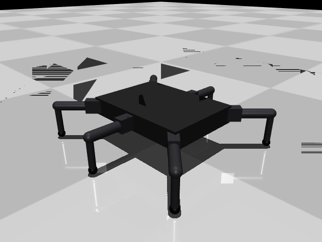

# Hexapod CAD

CAD and simulation files for a six-legged walking robot, built for a final-year
robotics project (TU Dublin, TU857). The robot is designed in Fusion 360 and
trained with reinforcement learning in MuJoCo.



## Robot at a glance

| | |
|---|---|
| Legs | 6, three per side, 3 joints each (hip yaw, femur pitch, knee) |
| Servos | 18 × Feetech STS3215 C018 (12 V serial bus) |
| Leg lengths | femur 75 mm, tibia 80 mm |
| Hip layout | 240 × 170 mm, corner legs angled out 45° |
| Joint limits | hip ±30°, femur ±60°, knee ±60° |
| Battery | 3S LiPo, 2200 mAh |
| Controller | ESP32-S3 + Waveshare bus servo adapter |
| IMU | Adafruit BNO085 |
| Printer | Elegoo Centauri Carbon 2 (256 mm bed) |
| Materials | PETG for structure, TPU 95A for feet |

## Folders

| Folder | Contents |
|---|---|
| `cad/` | Fusion 360 archives (`.f3z`), which include linked part files |
| `step/` | STEP exports, for opening in any CAD program |
| `stl/` | Printable parts |
| `sim/` | MuJoCo model and the script that generates it |
| `docs/` | Notes and images |

## Simulation

`sim/gen_crab.py` builds `sim/crab.xml` from named dimensions and masses at the
top of the script, in the same spirit as Fusion's user parameters. Change a
number, then rebuild:

```sh
pip install mujoco
python sim/gen_crab.py
python -m mujoco.viewer --mjcf sim/crab.xml
```

The model uses simple shapes (boxes, capsules, spheres) rather than meshes, so
it trains fast. Values still to confirm on the real robot: the hip-to-femur
offset (`COXA_LEN`), the masses, the servo position gain and foot friction.

## Status

- [x] Leg design (hip bracket, thigh, femur, calf, foot)
- [x] Leg spacing and clearance tests
- [x] Bottom body plate with servo pockets
- [x] MuJoCo model
- [ ] Top plate, standoffs and electronics mounts
- [ ] Wiring harness
- [ ] First printed leg and servo tests
- [ ] RL training

The servo model used in the assemblies came from a third party and is not
included here.
